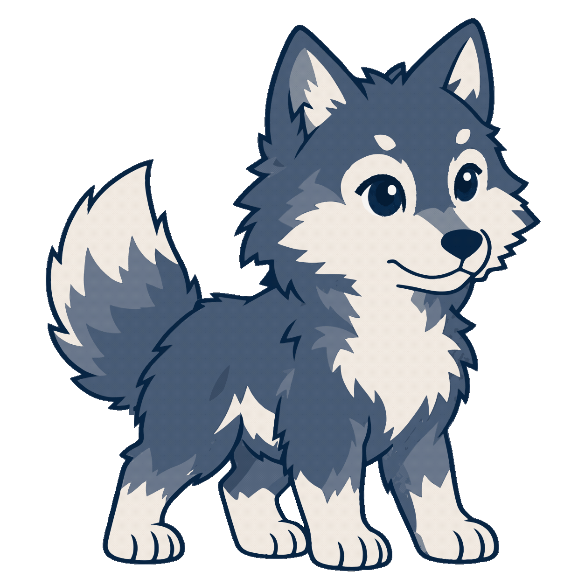

<p align="center">
  
</p>

<h1 align="center">Skadi</h1>
<p align="center"><b>Sistema de Monitoramento Térmico e Prevenção de Perdas</b></p>

<p align="center">
  
  
  
  
</p>

---

## Descrição

<table>
<tr>
<td valign="middle">

O **Skadi** é uma plataforma B2B para o monitoramento contínuo e inteligente de temperatura em Centros de Distribuição (CDs) de alimentos perecíveis.

**O problema:** oscilações de temperatura em câmaras frias, quando não percebidas a tempo, estragam a carga e geram perdas financeiras, operacionais e sanitárias.

**A solução:** o sistema recebe os dados de sensores e termômetros IoT de terceiros, aplica inteligência artificial para diagnosticar a causa das oscilações, prevê a degradação dos alimentos e dispara alertas hierárquicos para que a equipe aja antes de a perda acontecer.

</td>
<td align="center" valign="middle" width="220">
  
</td>
</tr>
</table>

---

## Funcionalidades Apresentadas no Repositório

- Cadastro e gestão de equipamentos (freezers e câmaras) e vinculação de termômetros.
- Limites mínimo e máximo de temperatura por produto.
- Consulta, edição e exclusão dos dados administrativos (CRUD).
- Landing page institucional do projeto.

---

## Links rápidos

| Recurso | Link |
|---|---|
| 🌐 Site publicado (GitHub Pages) | _[colar link]_ |
| 🎨 Protótipo no Figma | [Abrir protótipo](https://www.figma.com/design/6F45MNIkOeqfWnABSLFkRi/Skadi-Primeiro-Ano?node-id=0-1&t=YlQTJXhjWOrd0fkB-1) |
| 📦 Repositório | https://github.com/Skadi-Interdisciplinar/1_ano |
| 📄 Documento de entregas | _[colar link]_ |

---

---

## Estrutura do repositório

```text
1_ano/
├── .offline-markdown-preview/
│   └── remote-images/
├── HTMLs/
│   ├── Imagens/
│   │   ├── equipe/
│   │   └── fontes/
│   ├── crud/
│   ├── landing/
├── Inter/
│   ├── Banco_de_dados_skadi/
│   │   ├── banco_skadi_primeiro.sql
│   │   └── dataload_banco_skadi_primeiro.sql
│   └── Skadi_beck-end/
│       ├── .idea/
│       ├── .mvn/wrapper/
│       ├── src/main/
│       │   ├── java/com/example/skadi_beck_end/
│       │   │   ├── connection/
│       │   │   ├── dao/
│       │   │   ├── model/
│       │   │   ├── servlet/
│       │   │   ├── util/
│       │   │   └── HelloServlet.java
│       │   └── webapp/
│       │       ├── Imagens/
│       │       │   ├── equipe/
│       │       │   └── fontes/
│       │       ├── WEB-INF/
│       │       │   ├── jspf/
│       │       │   └── web.xml
│       │       ├── css/
│       │       ├── js/
│       │       └── *.jsp
│       ├── .gitignore
│       ├── Dockerfile
│       ├── mvnw
│       ├── mvnw.cmd
│       └── pom.xml
├── .gitignore
├── LICENSE
└── README.md
```

### Raiz

| Item | O que é |
|---|---|
| `.offline-markdown-preview/remote-images/` | Imagens usadas na apresentação visual do README (banner, tags e mascote Trimmy). Não fazem parte do sistema. |
| `HTMLs/` | Códigos referentes ao desenvolvimento visual web. |
| `Inter/` | Código Java e SQL do projeto Interdisciplinar. |
| `.gitignore` | Lista de arquivos que o Git ignora (ex.: variáveis de ambiente `.env`, arquivos de IDE e build). |
| `LICENSE` | Arquivo de licença do repositório. |
| `README.md` | Este documento. |

### `HTMLs/`

| Item | O que é |
|---|---|
| `crud/` | Códigos HTML, CSS e JS referentes às páginas de CRUD. |
| `landing/` | Códigos HTML, CSS e JS referentes à landing page. |
| `Imagens/` | Recursos visuais utilizados nos códigos de desenvolvimento web. |
| `Imagens/equipe/` | Imagens de cada participante da equipe Skadi. |
| `Imagens/fontes/` | Fontes utilizadas. |

### `Inter/Banco_de_dados_skadi/`

| Arquivo | O que é |
|---|---|
| `banco_skadi_primeiro.sql` | Script SQL de criação do banco de dados (PostgreSQL), construído a partir do modelo lógico. |
| `dataload_banco_skadi_primeiro.sql` | Script DataLoad com a carga inicial de dados nas tabelas do projeto. |

### `Inter/Skadi_beck-end/`

Projeto Maven (aberto no IntelliJ) da aplicação web em Java, com Servlets, DAO, JDBC e páginas JSP.

| Item | O que é |
|---|---|
| `.idea/` | Configurações do IntelliJ IDEA. |
| `.mvn/wrapper/` | Maven Wrapper: permite compilar o projeto sem ter o Maven instalado. |
| `pom.xml` | Dependências e configuração de build do Maven. |
| `mvnw` e `mvnw.cmd` | Scripts do Maven Wrapper (Linux/macOS e Windows). |
| `Dockerfile` | Receita para empacotar a aplicação em um container. |
| `.gitignore` | Arquivos ignorados pelo Git neste projeto. |
| `src/main/java/.../` | Código-fonte Java, dividido em camadas (detalhado abaixo). |
| `src/main/webapp/` | Interface web: páginas JSP, estilos, scripts e imagens (detalhado abaixo). |

#### Código Java (`src/main/java/com/example/skadi_beck_end/`)

| Pacote | Conteúdo |
|---|---|
| `connection/` | `ConnectionFactory` (conexão JDBC com o PostgreSQL), `Teste` e `TesteConexao` (classes para testar a conexão). |
| `dao/` | Acesso ao banco, uma classe por entidade: `CDDAO`, `CategoriaDAO`, `EnderecoDAO`, `FrigorificoDAO`, `LoteDAO`, `TermometroDAO` e `UsuarioDAO`. |
| `model/` | Classes de modelo (entidades): `CD`, `Categoria`, `Endereco`, `Frigorifico`, `Lote`, `Termometro` e `Usuario`. |
| `servlet/` | Controladores HTTP que recebem e respondem as requisições: um servlet por entidade (`CDServlet`, `CategoriaServlet`, `EnderecoServlet`, `FrigorificoServlet`, `LoteServlet`, `TermometroServlet`, `UsuarioServlet`) mais `LoginServlet` e `RecuperarSenhaServlet`. |
| `util/` | Classes de apoio: `EmailUtil` (envio de e-mails, como na recuperação de senha) e `Validator` (validação de dados de entrada). |
| `HelloServlet.java` | Servlet de exemplo, criado no início do projeto. |

#### Interface web (`src/main/webapp/`)

| Item | O que é | 
|---|---|
| `WEB-INF/web.xml` | Configuração da aplicação web. |
| `WEB-INF/jspf/` | Trechos de JSP reaproveitados nas páginas: `topo-crud.jspf`, `icones-crud.jspf` e `erro-form.jspf`. |
| `css/` | Estilos por página: `styleLanding`, `styleSobreNos`, `styleCadastro`, `styleLoginCliente`, `styleLoginSistema`, `styleCrud`, `styleUnidades`, `styleMensagem`, `styleTrimmy` e `monitoramento`. |
| `js/` | Scripts das páginas: `landing.js`, `sobreNos.js`, `cadastro.js` e `crud.js`. |
| `Imagens/` | Ilustrações e ícones em SVG (mascote Trimmy, alertas, dashboards, celular etc.) e o `ui kit.png`. |
| `Imagens/equipe/` | Imagens de cada participante da equipe. |
| `Imagens/fontes/` | Fontes utilizadas (Inter e Manrope). |
| `landing.jsp`, `sobre-nos.jsp`, `ajuda-trimmy.jsp` | Landing page, página *Sobre nós* e página de ajuda com a Trimmy. |
| `login.jsp`, `login-cliente.jsp`, `login-sistema.jsp`, `cadastro.jsp` | Telas de acesso e criação de conta. |
| `esqueci-senha.jsp`, `redefinir-senha.jsp`, `msg-enviada.jsp` | Fluxo de recuperação de senha e confirmação de envio. |
| `form-*.jsp` | Formulários de cadastro e edição de cada entidade (categoria, cd, endereço, frigorífico, lote, termômetro, usuário). |
| `lista-*.jsp` | Telas de listagem e consulta de cada entidade, com acesso à edição e exclusão. |
---

## Tecnologias Utilizadas

<p>
  
  
  
  
  
  
  
</p>

- **Backend:** Java (Servlets, DAO e JDBC).
- **Dados:** PostgreSQL.
- **Frontend:** HTML5, CSS e JavaScript.
- **UI/UX:** Figma.

---

## Como contribuir

O Skadi é um projeto privado e **não aceita Pull Requests externos**. Para a equipe e colaboradores autorizados:

1. Crie uma branch a partir da `main`: `git checkout -b feature/nome-da-funcionalidade`
2. Faça commits pequenos e descritivos.
3. Abra um Pull Request e peça revisão de pelo menos um integrante da equipe.
4. Para reportar bugs, abra uma *issue* com os passos para reproduzir.

---

## Autores e Créditos

Projeto Interdisciplinar desenvolvido no **Instituto J&F Germinare Tech**.

| Integrante | E-mail |
|---|---|
| Daniel Pavesi Rissato | daniel.20260051@institutojef.org.br |
| Isabella Araujo de Omena | isabella.20260118@institutojef.org.br |
| Maria Luísa Passos Vieira | maria.20260289@institutojef.org.br |
| Vinicius Guerra Menezes de Sousa | vinicius.20260273@institutojef.org.br |

---

## Licença

Este projeto é um software de **propriedade privada**. O uso, a replicação ou a redistribuição sem autorização prévia dos desenvolvedores e mantenedores do projeto Skadi é estritamente proibido.

<p align="center">
  
</p>