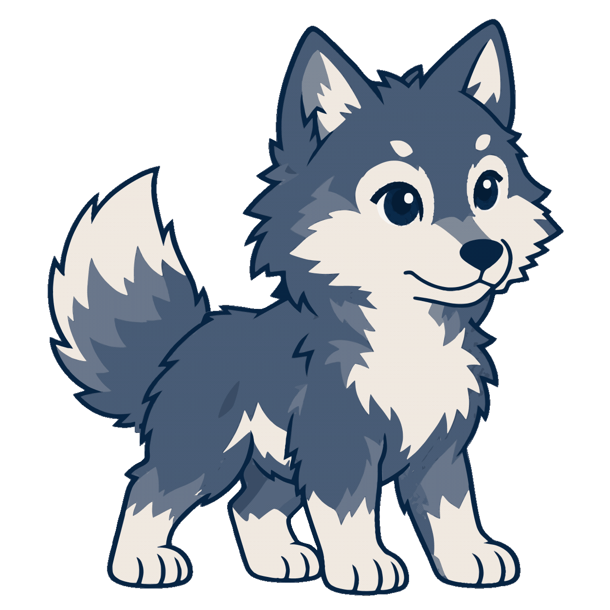

<p align="center">
  
</p>

<h1 align="center">Skadi</h1>
<p align="center"><b>Sistema de Monitoramento Térmico e Prevenção de Perdas</b></p>

<p align="center">
  
  
  
  
</p>

---

## Descrição

<table>
<tr>
<td valign="middle">

O **Skadi** é uma plataforma B2B para o monitoramento contínuo e inteligente de temperatura em Centros de Distribuição (CDs) de alimentos perecíveis.

**O problema:** oscilações de temperatura em câmaras frias, quando não percebidas a tempo, estragam a carga e geram perdas financeiras, operacionais e sanitárias.

**A solução:** o sistema recebe os dados de sensores e termômetros IoT de terceiros, aplica inteligência artificial para diagnosticar a causa das oscilações, prevê a degradação dos alimentos e dispara alertas hierárquicos para que a equipe aja antes de a perda acontecer.

</td>
<td align="center" valign="middle" width="220">
  
</td>
</tr>
</table>

---

## Funcionalidades Apresentadas no Repositório

- Cadastro e gestão de equipamentos (freezers e câmaras) e vinculação de termômetros.
- Limites mínimo e máximo de temperatura por produto.
- Consulta, edição e exclusão dos dados administrativos (CRUD).
- Landing page institucional do projeto.

---

## Links rápidos

| Recurso | Link |
|---|---|
| 🌐 Site publicado (Render) | https://skadi-site.onrender.com/ |
| 🎨 Protótipo no Figma | [Abrir protótipo](https://www.figma.com/design/6F45MNIkOeqfWnABSLFkRi/Skadi-Primeiro-Ano?node-id=0-1&t=YlQTJXhjWOrd0fkB-1) |
| 📦 Repositório | https://github.com/Skadi-Interdisciplinar/1_ano |

---

---

## Estrutura do repositório

```text
1_ano/
├── .offline-markdown-preview/
│   └── remote-images/
├── HTMLs/
│   ├── Imagens/
│   │   ├── equipe/
│   │   └── fontes/
│   ├── crud/
│   ├── landing/
├── Inter/
│   ├── Banco_de_dados_skadi/
│   │   ├── banco_skadi_primeiro.sql
│   │   ├── dataload_banco_skadi_primeiro.sql
│   │   └── roles.sql
│   └── Skadi_beck-end/
│       ├── .idea/
│       ├── .mvn/wrapper/
│       ├── src/main/
│       │   ├── java/com/example/skadi_beckend/
│       │   │   ├── connection/
│       │   │   ├── dao/
│       │   │   ├── model/
│       │   │   ├── servlet/
│       │   │   ├── util/
│       │   │   └── HelloServlet.java
│       │   ├── resources/email/
│       │   └── webapp/
│       │       ├── Imagens/
│       │       │   ├── equipe/
│       │       │   └── fontes/
│       │       ├── WEB-INF/
│       │       │   ├── jspf/
│       │       │   └── web.xml
│       │       ├── css/
│       │       ├── js/
│       │       └── *.jsp
│       ├── .gitignore
│       ├── Dockerfile
│       ├── mvnw
│       ├── mvnw.cmd
│       └── pom.xml
├── .gitignore
├── LICENSE
└── README.md
```

### Raiz

| Item | O que é |
|---|---|
| `.offline-markdown-preview/remote-images/` | Imagens usadas na apresentação visual do README (banner, tags e mascote Trimmy). Não fazem parte do sistema. |
| `HTMLs/` | Códigos referentes ao desenvolvimento visual web. |
| `Inter/` | Código Java e SQL do projeto Interdisciplinar. |
| `.gitignore` | Lista de arquivos que o Git ignora (ex.: variáveis de ambiente `.env`, arquivos de IDE e build). |
| `LICENSE` | Arquivo de licença do repositório. |
| `README.md` | Este documento. |

### `HTMLs/`

| Item | O que é |
|---|---|
| `crud/` | Códigos HTML, CSS e JS referentes às páginas de CRUD. |
| `landing/` | Códigos HTML, CSS e JS referentes à landing page. |
| `Imagens/` | Recursos visuais utilizados nos códigos de desenvolvimento web. |
| `Imagens/equipe/` | Imagens de cada participante da equipe Skadi. |
| `Imagens/fontes/` | Fontes utilizadas. |

### `Inter/Banco_de_dados_skadi/`

| Arquivo | O que é |
|---|---|
| `banco_skadi_primeiro.sql` | Script SQL de criação do banco de dados (PostgreSQL), construído a partir do modelo lógico. |
| `dataload_banco_skadi_primeiro.sql` | Script DataLoad com a carga inicial de dados nas tabelas do projeto (dados de teste). |
| `roles.sql` | Grupos e usuários do PostgreSQL da equipe: `fronts` (só insere dados) e `dados_back` (acesso total). |

### `Inter/Skadi_beck-end/`

Projeto Maven (aberto no IntelliJ) da aplicação web em Java, com Servlets, DAO, JDBC e páginas JSP.

| Item | O que é |
|---|---|
| `.idea/` | Configurações do IntelliJ IDEA. |
| `.mvn/wrapper/` | Maven Wrapper: permite compilar o projeto sem ter o Maven instalado. |
| `pom.xml` | Dependências e configuração de build do Maven. |
| `mvnw` e `mvnw.cmd` | Scripts do Maven Wrapper (Linux/macOS e Windows). |
| `Dockerfile` | Receita para empacotar a aplicação em um container. |
| `.gitignore` | Arquivos ignorados pelo Git neste projeto. |
| `src/main/java/.../` | Código-fonte Java, dividido em camadas (detalhado abaixo). |
| `src/main/resources/email/` | Logo usada no e-mail de recuperação de senha. |
| `src/main/webapp/` | Interface web: páginas JSP, estilos, scripts e imagens (detalhado abaixo). |

#### Código Java (`src/main/java/com/example/skadi_beckend/`)

| Pacote | Conteúdo |
|---|---|
| `connection/` | `ConnectionFactory` (conexão JDBC com o PostgreSQL), `Teste` e `TesteConexao` (classes para testar a conexão). |
| `dao/` | Manipula operações da tabela e controla o acesso ao banco, uma classe por entidade: `CDDAO`, `CategoriaDAO`, `EnderecoDAO`, `FrigorificoDAO`, `LoteDAO`, `TermometroDAO` e `UsuarioDAO`. |
| `model/` | Classes de modelo (entidades): `CD`, `Categoria`, `Endereco`, `Frigorifico`, `Lote`, `Termometro` e `Usuario`. |
| `servlet/` | Controladores HTTP que recebem e respondem as requisições: um servlet por entidade (`CDServlet`, `CategoriaServlet`, `EnderecoServlet`, `FrigorificoServlet`, `LoteServlet`, `TermometroServlet`, `UsuarioServlet`) mais `LoginServlet`, `RecuperarSenhaServlet`, `ContatoServlet` (Contate-nos) e `AreaRestritaServlet` (botão Área restrita). |
| `util/` | Classes de apoio: `Acesso` (níveis de acesso e conta logada), `Configuracao` (leitura das variáveis de ambiente), `EmailUtil` (envio de e-mails pela API do Brevo: recuperação de senha e Contate-nos) e `Validator` (validação de dados de entrada). |
| `HelloServlet.java` | Servlet de exemplo, criado no início do projeto. |

#### Interface web (`src/main/webapp/`)

| Item | O que é | 
|---|---|
| `WEB-INF/web.xml` | Configuração da aplicação web. |
| `WEB-INF/jspf/` | Trechos de JSP reaproveitados nas telas de CRUD: `cabeca-crud.jspf`, `topo-crud.jspf` e `tabela-crud.jspf`. |
| `css/` | Estilos por página: `styleIndex` (landing), `styleSobreNos`, `styleContato`, `styleLoginCliente`, `styleLoginSuperAdmin`, `styleEsqueci`, `styleCrud`, `styleCds` e `styleMensagem`. |
| `js/` | Scripts das páginas: `index.js` e `monitoramento.js` (landing), `sobreNos.js`, `crud.js` e `crudIcones.js` (base dos CRUDs), `crudServidor.js` (ligação dos CRUDs com os servlets) e um arquivo por CRUD (`cds.js`, `funcionarios.js`, `frigorificos.js`, `termometros.js`, `lotes.js`, `categorias.js`, `enderecos.js`). |
| `Imagens/` | Ilustrações e ícones em SVG (alertas, dashboards, celular etc.). |
| `Imagens/equipe/` | Imagens de cada participante da equipe. |
| `Imagens/fontes/` | Fontes utilizadas (Inter e Manrope). |
| `landing.jsp`, `sobre-nos.jsp` | Landing page e página *Sobre nós*. |
| `contato.jsp`, `msg-enviada.jsp` | *Contate-nos* (mensagem enviada por e-mail para a equipe) e confirmação de envio. |
| `login.jsp`, `login-cliente.jsp`, `login-super-admin.jsp` | Telas de acesso: clientes (admin) e equipe Skadi (super_admin). |
| `esqueci-senha.jsp`, `esqueci-codigo.jsp`, `redefinir-senha.jsp` | Fluxo de recuperação de senha. |
| `area-restrita-indisponivel.jsp`, `acesso-negado.jsp`, `erro-servidor.jsp` | Avisos: Área restrita sem link, acesso sem permissão e erro no servidor. |
| `form-*.jsp` | Formulários de cadastro e edição de cada entidade (categoria, cd, endereço, frigorífico, lote, termômetro, usuário). |
| `lista-*.jsp` | Telas de listagem e consulta de cada entidade, com acesso à edição e exclusão. |

---

## Tecnologias Utilizadas

<p>
  
  
  
  
  
  
  
</p>

- **Backend:** Java (Servlets, DAO e JDBC).
- **Dados:** PostgreSQL.
- **Frontend:** JSP (JSTL), HTML5, CSS3 e JavaScript.
- **E-mail:** API do Brevo (recuperação de senha e *Contate-nos*).
- **Publicação:** Render, com Docker e Tomcat 10.1 (`Dockerfile`).

---

## Como rodar localmente

1. Crie o banco no PostgreSQL rodando, nesta ordem, `banco_skadi_primeiro.sql` e `dataload_banco_skadi_primeiro.sql` (pasta `Inter/Banco_de_dados_skadi/`).
2. Crie o arquivo `.env` na pasta de onde o Tomcat é iniciado, com as variáveis da tabela abaixo.
3. Abra `Inter/Skadi_beck-end/` no IntelliJ e rode no Tomcat 10.1 (Java 11 ou mais novo).

> O `.env` está no `.gitignore`: senhas e chaves **nunca** vão para o GitHub.

---

## Variáveis de ambiente

O sistema lê cada variável nesta ordem: VM Options do IntelliJ (`-DNOME=valor`), variáveis do sistema (no Render, em **Environment**) e, por último, o arquivo `.env`.

| Variável | Obrigatória | Para que serve |
|---|---|---|
| `POSTGRES_URL` | Sim | Endereço JDBC do banco (ex.: `jdbc:postgresql://localhost:5432/skadi_primeiro`). |
| `POSTGRES_USER` | Sim | Usuário do banco. |
| `POSTGRES_PASSWORD` | Sim | Senha do usuário do banco. |
| `EMAIL_USER` | Sim | E-mail remetente da Skadi. Precisa estar confirmado no Brevo (*Senders*). |
| `BREVO_API_KEY` | Sim | Chave de API do Brevo, usada para enviar os e-mails. |
| `CONTACT_EMAIL` | Não | Quem recebe as mensagens do *Contate-nos*. Sem ela, vai para o `EMAIL_USER`. |
| `EMAIL_LOGO_URL` | Não | Link público da logo do e-mail. Sem ela, usa a logo do repositório no GitHub. |
| `AWS_URL_AREA_RESTRITA` | Não | Link do botão *Área restrita* (CRUD da equipe Skadi na AWS). Sem ela, o botão mostra um aviso. |

Exemplo de `.env` (troque os valores):

```text
POSTGRES_URL=jdbc:postgresql://localhost:5432/skadi_primeiro
POSTGRES_USER=postgres
POSTGRES_PASSWORD=sua_senha_do_banco
EMAIL_USER=skadi.enterprise@gmail.com
BREVO_API_KEY=sua_chave_do_brevo
AWS_URL_AREA_RESTRITA=
```
